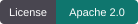

# Nexscope Ecommerce AI Tools

**Ecommerce Data APIs for builders. Free product listings for sellers.**

   

Find the data for your next workflow, or give your product a free public page built for search and AI discovery. Start with the two features on [Nexscope Learn](https://learn.nexscope.ai/?utm_source=github&utm_medium=referral&utm_campaign=ecommerce_ai_tools&utm_content=readme_home).

| What do you want to do? | Start here |
| --- | --- |
| Find ecommerce data for an application, research task or AI workflow | **[Explore the Data API directory →](https://learn.nexscope.ai/data/?utm_source=github&utm_medium=referral&utm_campaign=ecommerce_ai_tools&utm_content=readme_primary_data)** |
| Give your product a public page with facts, images and a link to your store | **[List your product for free →](https://learn.nexscope.ai/ecommerce-ai-tools/product-showcase/submit/?utm_source=github&utm_medium=referral&utm_campaign=product_gallery_launch&utm_content=readme_primary_gallery)** |

## 1. Data APIs: find the right operation before you build

Browse ecommerce APIs for Amazon, TikTok, 1688, Shopify, Shopee, Walmart and other platforms. Filter by platform, search for the information you need, and open the exact official API documentation and online test.

- **Find the data for your task:** product search, reviews, sourcing, keywords, marketplace research and more.
- **Compare operations:** inspect descriptions and recorded usage before choosing a starting point.
- **Test, then integrate:** check the required inputs, returned fields, coverage and credit requirements in the official documentation.

**[Explore Data APIs →](https://learn.nexscope.ai/data/?utm_source=github&utm_medium=referral&utm_campaign=ecommerce_ai_tools&utm_content=readme_data_feature)** · [API selection guide](docs/guides/api-capabilities.md) · [Official API documentation](https://www.nexscope.ai/api-docs?co-from=learn&utm_source=github&utm_medium=referral&utm_campaign=ecommerce_ai_tools&utm_content=readme_data_docs)

The directory is free to browse. API requests follow each operation's account, access and credit requirements.

## 2. Product Gallery: list and display your product completely free

Give search and AI systems a clearer source about what you sell. An approved Gallery page brings your product facts, images, optional video and original store link together in one public page. This can support **AI discovery and generative engine optimization (GEO)**, while shoppers follow the link to your store to buy.

**Product submission, editorial review, and approved listing and display are completely free.** No payment or store account connection is required.

1. **Add your product:** share a public product URL or Amazon ASIN, accurate product details and at least one clear image.
2. **Save your private management link:** check status, read editorial feedback and make changes when needed.
3. **Get a public page after approval:** your product remains offline until reviewed, approved and published.

**[List your product for free →](https://learn.nexscope.ai/ecommerce-ai-tools/product-showcase/submit/?utm_source=github&utm_medium=referral&utm_campaign=product_gallery_launch&utm_content=readme_gallery_feature)** · [Browse the Product Gallery](https://learn.nexscope.ai/ecommerce-ai-tools/product-showcase/?utm_source=github&utm_medium=referral&utm_campaign=product_gallery_launch&utm_content=readme_gallery_browse) · [Join the product-page clinic](https://github.com/nexscope-ai/ecommerce-ai-tools/discussions/16)

A public product page provides another source of product information. Publication, indexing, AI citations, traffic and sales are not guaranteed.

## About Nexscope

Nexscope helps ecommerce teams research marketplaces, analyze customer feedback, improve listings and search visibility, create product images and videos, and connect data to their own applications or AI agents through REST APIs and MCP. Sellers can use the browser tools; developers can inspect endpoint schemas, examples, and access requirements in the [API documentation](https://www.nexscope.ai/api-docs?co-from=learn&utm_source=github&utm_medium=referral&utm_campaign=api_docs_launch&utm_content=readme_api_1).

Credit use and API access vary by action and account. Check the selected operation's official documentation for current requirements.

### What this repository contains

- **Practical guides** under [`docs/guides/`](docs/guides/) for marketplace research, listing improvement, creative production, SEO, REST APIs and MCP.
- **Dated evidence and case studies** under [`docs/api-evidence/`](docs/api-evidence/) and [`docs/case-studies/`](docs/case-studies/) with observed outputs, limitations and source context.
- **Public learning-site source** under [`docs/`](docs/) and maintenance scripts under [`scripts/`](scripts/) for the Product Gallery and documentation build.
- **Community contribution paths** through [Discussions](https://github.com/nexscope-ai/ecommerce-ai-tools/discussions), [Issues](https://github.com/nexscope-ai/ecommerce-ai-tools/issues/new/choose) and pull requests governed by [`CONTRIBUTING.md`](CONTRIBUTING.md).

The hosted Nexscope application, credentials, private operations and customer data are outside this repository. Public examples should be treated as reproducible references rather than guaranteed live results.

## Explore ecommerce tools

Create or refine product visuals, then investigate Amazon, 1688 and TikTok Shop signals before deciding what to test.

| Your goal | Tool | What to expect |
| --- | --- | --- |
| Create product images and ad concepts | [AI Product Image Generator](https://www.nexscope.ai/tools/ai-image-generator?co-from=learn&utm_source=github&utm_medium=referral&utm_campaign=ai_image_generator_launch&utm_content=readme_tools) | Choose an image model and review product accuracy before publishing. |
| Turn product images into videos | [AI Video Generator](https://www.nexscope.ai/tools/ai-video-generator?co-from=learn&utm_source=github&utm_medium=referral&utm_campaign=ai_video_generator_launch&utm_content=readme_tools) | Upload images, choose a model and motion prompt, then preview the result. |
| Audit and optimize an Amazon listing | [AI Amazon Listing Optimizer](https://www.nexscope.ai/tools/amazon-listing-optimization-tool?co-from=learn&utm_source=github&utm_medium=referral&utm_campaign=amazon_listing_optimizer_launch&utm_content=readme_tools) | Review ASIN, keyword, traffic and history evidence before testing listing changes. |
| Learn from competitor complaints | [Amazon Review Analyzer](https://www.nexscope.ai/tools/amazon-review-analyzer?co-from=learn&utm_source=github&utm_medium=referral&utm_campaign=tools_launch&utm_content=readme_reviews) | Analyze a bounded low-star review sample and form testable product questions. |
| Find wholesale candidates from an Amazon product | [Amazon to 1688 Supplier Finder](https://learn.nexscope.ai/tools/amazon-to-1688-supplier-finder/?utm_source=github&utm_medium=referral&utm_campaign=tools_launch&utm_content=readme_1688) | Find visually similar 1688 listings, then inspect selected supplier terms and MOQ. A visual match does not prove factory identity. |
| Validate a TikTok Shop product signal | [TikTok Shop New-Product Validator](https://learn.nexscope.ai/tools/tiktok-shop-new-product-validator/?utm_source=github&utm_medium=referral&utm_campaign=tools_launch&utm_content=readme_tiktok_products) | Start from a dated ranking and compare sales windows and related video evidence for selected products. |
| Research creators connected to a product | [TikTok Shop Product-to-Creator Match](https://learn.nexscope.ai/tools/tiktok-shop-creator-match/?utm_source=github&utm_medium=referral&utm_campaign=tools_launch&utm_content=readme_tiktok_creators) | Shortlist associated creators, then inspect profiles and product-tagged videos before outreach. |
| Explore keywords and competing products | [SEO Keyword Planner](https://learn.nexscope.ai/tools/seo-keyword-planner/?utm_source=github&utm_medium=referral&utm_campaign=tools_launch&utm_content=readme_keywords) | Explore US English Google keyword metrics, Amazon US product research and an optional AI comparison report. |
| Inspect a page's SEO evidence | [Website SEO Auditor](https://www.nexscope.ai/tools/website-seo-auditor?co-from=learn&utm_source=github&utm_medium=referral&utm_campaign=tools_launch&utm_content=readme_auditor) | Check page-level SEO evidence and optionally request a mobile Lighthouse check. |

**[View more ecommerce tools →](https://learn.nexscope.ai/tools/?utm_source=github&utm_medium=referral&utm_campaign=tools_launch&utm_content=readme_more_tools)**

The Amazon-to-1688, TikTok Shop and SEO Keyword Planner workflows accept a visitor-provided API key; other tools may require sign-in. Credits may apply to requests you start.

## Guides and evidence

| Question | Start with |
| --- | --- |
| How can I analyze negative Amazon reviews and find product improvements? | [Review analysis guide](docs/guides/amazon-negative-review-analysis.md) and [dated case study](docs/case-studies/amazon-review-case-study.md) |
| How can I plan ecommerce keywords and check competing products? | [SEO Keyword Planner workflow](docs/guides/seo-keyword-planner.md) and [dated API test](docs/api-evidence/portable-blender-keyword-competitor.md) |
| How can I audit an ecommerce product page? | [Website SEO audit guide](docs/guides/website-seo-audit-guide.md) |
| How can I optimize an Amazon listing with evidence? | [Listing optimization guide](docs/guides/amazon-listing-optimization-tool.md) |
| How can I create accurate product images or videos? | [Image guide](docs/guides/ai-product-image-generator.md) · [Video guide](docs/guides/ai-video-generator.md) |
| How can I use ecommerce data in an AI agent? | [API selection and integration guide](docs/guides/ecommerce-api-for-ai-agents.md) · [MCP server guide](docs/guides/what-is-an-mcp-server.md) |

Browse the [API evidence library](docs/api-evidence/index.md) for dated inputs, observed outputs, credit use, and limitations, or [recent ecommerce analysis](docs/ecommerce-trends/index.md) for current industry changes.

## Build with Nexscope APIs

The [API documentation](https://www.nexscope.ai/api-docs?co-from=learn&utm_source=github&utm_medium=referral&utm_campaign=api_docs_launch&utm_content=readme_api_2) provides endpoint parameters, response schemas, examples, online testing, and REST/MCP guidance. Common starting points include [Amazon Reviews List](https://www.nexscope.ai/api-docs/amazon-reviews-list?co-from=learn&utm_source=github&utm_medium=referral&utm_campaign=api_docs_launch&utm_content=readme_api_3), [Amazon Search](https://www.nexscope.ai/api-docs/amazon-search?co-from=learn&utm_source=github&utm_medium=referral&utm_campaign=api_docs_launch&utm_content=readme_api_4), [1688 Search by Image](https://www.nexscope.ai/api-docs/1688-search-by-image?co-from=learn&utm_source=github&utm_medium=referral&utm_campaign=api_docs_launch&utm_content=readme_api_5), [Shopify Product Query](https://www.nexscope.ai/api-docs/shopify-product-query?co-from=learn&utm_source=github&utm_medium=referral&utm_campaign=api_docs_launch&utm_content=readme_api_6), and the [MCP tool map](https://www.nexscope.ai/mcp-map?co-from=learn&utm_source=github&utm_medium=referral&utm_campaign=api_docs_launch&utm_content=readme_api_7).

External REST/MCP calls and the API tester require an account API key. Creative API key access requires an active subscription; trial credits do not unlock it. Confirm each endpoint's current inputs, access requirements, credit cost, and response schema before integrating. See the [integration guide](docs/guides/api-capabilities.md) and [API examples repository](https://github.com/nexscope-ai/nexscope-ecommerce-api).

## Community and support

| Need | Where to go |
| --- | --- |
| Ask a usage or integration question | [Discussions Q&A](https://github.com/nexscope-ai/ecommerce-ai-tools/discussions/categories/q-a) |
| Suggest a workflow or feature | [Discussions Ideas](https://github.com/nexscope-ai/ecommerce-ai-tools/discussions/categories/ideas) |
| Report a reproducible bug | [Issue forms](https://github.com/nexscope-ai/ecommerce-ai-tools/issues/new/choose) |
| Share a verified workflow | [Show and tell](https://github.com/nexscope-ai/ecommerce-ai-tools/discussions/categories/show-and-tell) |
| Get a focused public check on one product page | [Join this week's product-page clinic](https://github.com/nexscope-ai/ecommerce-ai-tools/discussions/16?utm_source=github&utm_medium=referral&utm_campaign=weekly_product_page_clinic&utm_content=readme_community) |

Start with the [welcome post](https://github.com/nexscope-ai/ecommerce-ai-tools/discussions/11) and [support process](SUPPORT.md). Describe your goal, the tool or endpoint, expected behavior, and observed result. Do not post API keys, tokens, payment details, private customer data, or unredacted screenshots. For private account or billing matters, contact [service@nexscope.ai](mailto:service@nexscope.ai). To improve these public resources, see [Contributing](CONTRIBUTING.md).

Related repositories: [Nexscope Ecommerce API](https://github.com/nexscope-ai/nexscope-ecommerce-api) · [Amazon Skills](https://github.com/nexscope-ai/Amazon-Skills) · [Ecommerce SEO and GEO Skills](https://github.com/nexscope-ai/ecommerce-seo-geo-skills).

Directory editors and curators can use the factual descriptions, tags and canonical links in the [directory listing kit](DIRECTORY.md). Security concerns should be reported privately according to the [security policy](SECURITY.md). This repository is available under the [Apache License 2.0](LICENSE); third-party assets retain their respective licenses.

Maintained by the official Nexscope team. Amazon and Google are trademarks of their respective owners; no affiliation or endorsement is implied.
